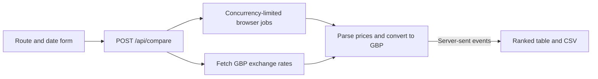

# Geo Fare Gap

A Next.js app that compares flight fares shown to different browsing countries. It sends one route and date to browser agents, converts prices to GBP and streams a ranked table with CSV export. Awarded an honourable mention (4th place) at a hackathon.

- **Orchestration:** TypeScript API starts one TinyFish browser job per site/country pair with a concurrency limit; React shows progress over server-sent events with live previews.
- **Separation:** price parsing and currency conversion are independent of the agent code.
- **Coverage:** nine site URL builders and seven countries.



## Run

Node.js 20+. Set `TINYFISH_API_KEY` in `.env.local`; `TINYFISH_CONCURRENCY` defaults to 2 (1–10).

```sh
npm ci && cp .env.example .env.local
npm run dev     # http://localhost:3000
npm test && npm run lint
```

## Limits

Agents can return different itineraries, so the table cannot prove a like-for-like price difference or its cause. There is no itinerary matching or booking, and not every site/country pair has been verified. See [docs/implementation.md](docs/implementation.md).
